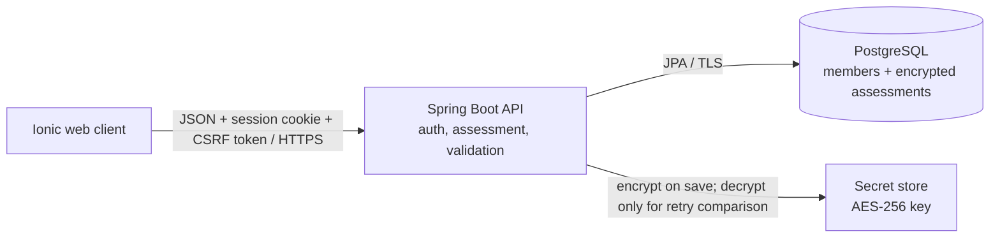

# Well Live backend proving slice

This is a Java 21 / Spring Boot REST API for `UC-ACC-complete-assessment`. It is a
single modular application, not a microservice set. The Ionic frontend remains
separate and communicates with it using JSON over HTTPS.

## Architecture



The browser is untrusted. Spring Security authenticates a member into an
HTTP-only session; the assessment owner is always taken from that principal, not
from request JSON. CSRF protection is required for state-changing requests.
The session ID is rotated on sign-in.
The assessment service applies the fixed questionnaire definition, validates
answers, normalizes skipped fields and saves one submission in one transaction.
The questionnaire is defined in backend code and served to the client by
`GET /api/assessment/form`; clients should render that response rather than
maintain a second question list. Updating the definition requires a backend
change and redeploy. It is not a live-editable database questionnaire.
The persistence layer enforces one assessment per member. AES-GCM encrypts the
complete normalized answer document before it reaches the relational database,
binding the ciphertext to the member ID as authenticated additional data.
Only the key configured outside the database can decrypt it.

| Component | Responsibility |
|---|---|
| `auth` | Registration, sign-in/out and trusted member principal |
| `assessment` | Form definition, server validation, normalization, submission and retry reconciliation |
| `security` | AES-GCM protection of health and profile answers |
| `repository` / `domain` | Member and assessment persistence |
| `error` | Safe RFC 9457-style errors; does not return answer values or stack traces |

### Request flow

1. The frontend fetches a CSRF token and sends it with registration or sign-in.
2. Registration records age-eligibility and terms/disclaimer acceptance, hashes
   the password with BCrypt, and starts a member session.
3. The authenticated client fetches the questionnaire definition. Answers remain
   in frontend memory until the member confirms; section validation does not
   persist anything.
4. On final submission the API verifies form version and answer IDs, normalizes
   every unanswered item to `SKIPPED`, validates numeric/basic-text boundaries,
   and requires short text when a concern question is answered as `OTHER`.
5. In a transaction, the API locks the member row, checks for a prior
   submission, AES-GCM encrypts the canonical answer JSON and inserts the
   assessment. The same submission ID and same normalized answers return the
   original completion timestamp; a changed retry or second assessment returns
   `409`.

## API contract

All routes use `/api`. Except for registration, sign-in and CSRF bootstrap, the
caller must have an authenticated session. Browser calls must include
credentials and the `X-XSRF-TOKEN` header set to the readable `XSRF-TOKEN`
cookie value. `/api/auth/csrf` initializes the cookie and returns the header
name; it deliberately does not echo the token in the response body.

| Method and path | Purpose |
|---|---|
| `GET /api/auth/csrf` | Set/read the CSRF token and return its header name |
| `POST /api/auth/register` | Create account; request has `email`, `password`, `ageEligibilityConfirmed`, `termsAccepted` |
| `POST /api/auth/login` | Start session; request has `email`, `password` |
| `GET /api/auth/me` | Return the authenticated member ID and email |
| `POST /api/auth/logout` | Invalidate the member session |
| `GET /api/assessment/form` | Return version 1, explanation, sections, stable item IDs, questions, input types, and answer options |
| `POST /api/assessment/section-validations` | Validate a pending section without saving |
| `POST /api/assessment` | Complete the authenticated member's assessment |

Assessment request example:

```json
{
  "formVersion": 1,
  "submissionId": "c07f7ce9-57f4-4f4e-a9f9-1cc6a50cdff4",
  "answers": {
    "age": { "value": "34" },
    "height": { "value": "170", "unit": "cm" },
    "skin_or_nail_changes": { "status": "CONCERN", "followUpText": "Optional detail" },
    "memory_difficulties": { "status": "OTHER", "value": "Occasional confusion" },
    "pain": { "status": "NO_CONCERN" }
  },
  "sectionFollowUps": {
    "family_relationship_concerns": "Optional detail if a family response was marked Concern"
  }
}
```

Concern items in the form response offer `CONCERN` (“Concern”),
`NO_CONCERN` (“No concern”), `SKIPPED` (“Skip”), and `OTHER` (“Others”)
in that order. `OTHER` is always the last option and requires a short
`value` of at most 500 Unicode code points. Typed fields such as height,
weight, age, ethnicity and language keep their own input types instead of
concern options. Prompt-level follow-ups (for example “Where?”) remain separate
from an “Others” answer.

The endpoint returns `201` with `formVersion` and `completedAt`. Failures use a
safe problem response containing `status`, `code`, `detail`, and optionally
field-specific validation errors. The service never logs or returns answer
payloads.

## Run locally

Requirements: JDK 21 and Maven 3.9+.

```sh
cd backend
export ASSESSMENT_ENCRYPTION_KEY="$(openssl rand -base64 32)"
mvn spring-boot:run
```

Local development uses an in-memory H2 database. Data is lost when the process
stops, so use fictitious accounts and answers only. Set `FRONTEND_ORIGIN` to the
Ionic dev-server origin if it differs from `http://localhost:8100`.

Run tests with `mvn test`.

For PostgreSQL, activate the `prod` profile and configure `DATABASE_URL`,
`DATABASE_USERNAME`, `DATABASE_PASSWORD`, `ASSESSMENT_ENCRYPTION_KEY`,
`FRONTEND_ORIGIN`, and `SESSION_COOKIE_SECURE=true`. Keep the encryption key in
a secret manager, separate from database backups; losing it makes stored
assessments unreadable. The production profile disables assessment collection
by default. Do not enable it until the open clinical/privacy decisions below
have been resolved and approved.

## Proving-slice boundaries

- The questionnaire text and section groups are taken from the
  [health assessment questionnaire](../docs/health%20assessment.docx); stable
  item IDs are API identifiers.
- This implements completion only. Editing an existing assessment, deletion
  workflows, personalization, account recovery, email verification, and
  throttling/lockout policy are outside this slice.
- Product and clinical review must confirm the response semantics, consent and
  data-use wording, collection/retention policy, and handling of sensitive
  disclosures (including self-harm/violence concerns) before real member data
  is collected. No alert, clinical triage, or emergency response is inferred.
- The account password policy and production hosting/key-management details
  still need team decisions. The endpoint currently enforces the BCrypt input
  limit but does not invent a minimum password policy.
- This is a proving slice, not a claim of HIPAA compliance or production
  readiness.
