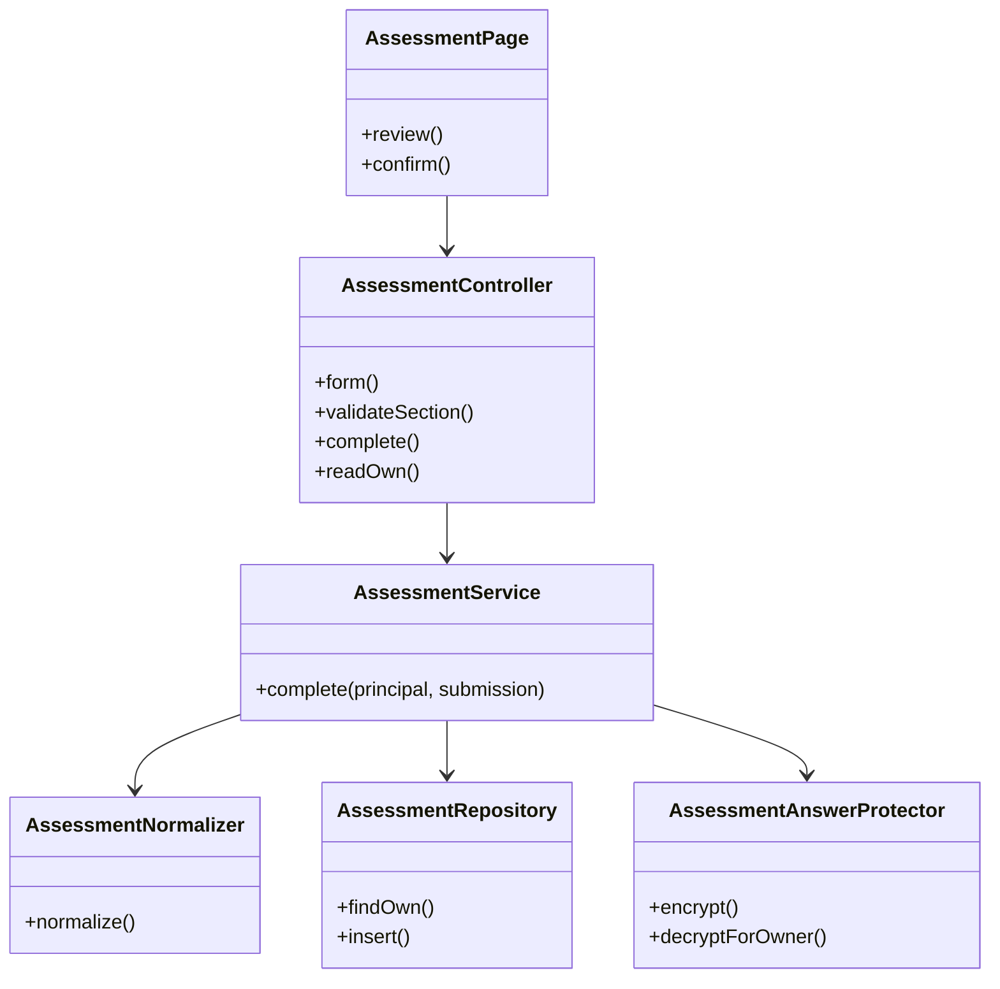
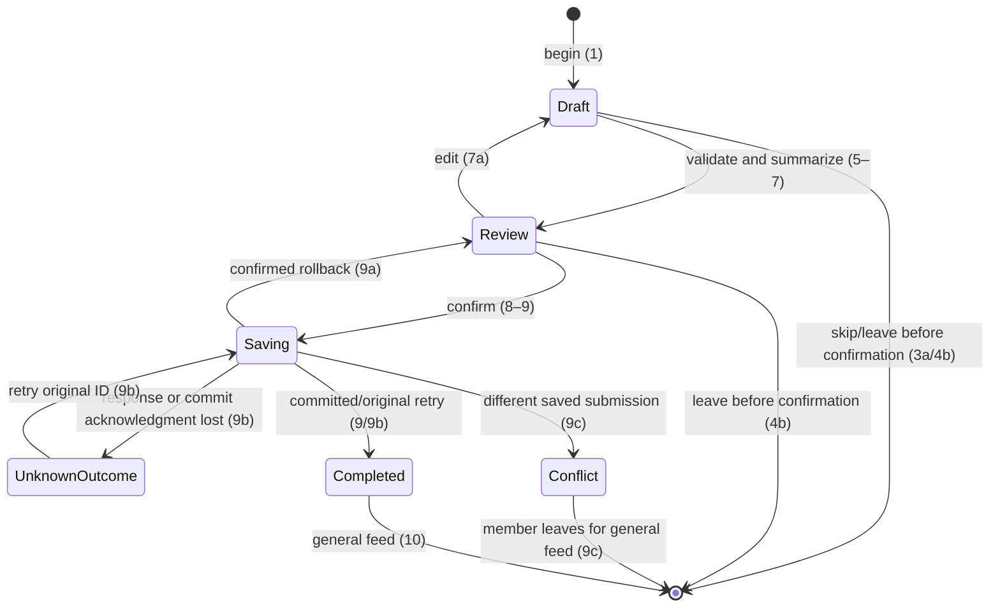

# Account and Profile Design

**Project:** Well Live
**Team:** Team 07
**Area:** ACC
**Status:** Corrected design for teammate review; not implementation authorization.

> **Realizes:** [UC-ACC-complete-assessment](../requirements/use-cases.md#uc-acc-complete-assessment-the-member-completes-the-health-and-wellness-assessment).
>
> **Depends on:** [BR-no-mandatory-health-disclosure and BR-health-data-protection](../requirements/business-rules.md#24-privacy-identity-and-data-handling), [BR-non-diagnostic](../requirements/business-rules.md#21-health-safety-and-clinical-boundaries), [BR-not-medical-device](../requirements/business-rules.md#25-regulatory-and-platform-constraints), [BR-five-pillars](../requirements/business-rules.md#22-content-and-topic-scope), and [SEC-protected-data](../requirements/software-requirements-specification.md#93-security).
>
> **See:** [SRS data dictionary](../requirements/software-requirements-specification.md#72-data-dictionary), [glossary](../requirements/project-glossary.md), [architecture](architectural-design.md), [open issues](../requirements/OPEN-ISSUES.md#open).
>
> **Designed against:** main `eea456b` (2026-11-06). No application, manifests or tests exist on main/current checkout. Teammate branch `origin/imnotpan05-patch-1` at `7dbea4f` contains an unmerged backend draft; it was inspected, not incorporated or approved.

> **Remote integration update:** `origin/integrate-health-assessment` at `58c3602` contains that backend plus React and Ionic React drafts. PR #44 merged into that integration branch, not main; its observed review is a bot comment, not two human approvals. Its design still states approval blockers. Preserve this work and reconcile it with the selected Ionic Vue stack after the corrected design is approved; no remote implementation is treated as accepted or verified here.

## Overview

ACC occupies the [Frontend Client and Backend API containers](architectural-design.md#51-containers). Its page-memory assessment draft calls backend validation and confirmation; the backend derives identity through Identity and Access and owns protected relational persistence. The general-feed destination is a shell, not a claim that the full content use case is built. The only read foundation of [UC-ACC-update-assessment steps 1–2](../requirements/use-cases.md#uc-acc-update-assessment-the-member-updates-their-assessment-answers) is owner-only retrieval; update/delete/history/personalization endpoints are outside this design.

The [completion UC](../requirements/use-cases.md#uc-acc-complete-assessment-the-member-completes-the-health-and-wellness-assessment) owns behavior and validation. This document owns implementation contracts and questionnaire IDs. New proposals remain subject to review; [OI-2, OI-8 through OI-10](../requirements/OPEN-ISSUES.md#open) are explicit implementation gates. Client questions block real-data use; the owner requires fictitious data for development and demonstration. This document alone authorizes neither implementation nor real collection.

Proposed step-2 demonstration notice for teammate review: “Development demonstration: use fictitious information only. Do not enter real assessment answers. Every item and follow-up is optional; you may skip individual items or the whole assessment. This demonstration tests saving and reviewing an assessment for the signed-in member. Answers are accessible only to their owning member. It provides no diagnosis or clinical advice and does not personalize the feed. Real collection purpose, retention and sensitive-selection handling await client decisions.” This is draft demonstration wording, not approved real-member consent or a claim of clinical monitoring.

## Components & classes

All planned files below are **new on main**, including files whose names align with the unmerged draft. Nothing is claimed as reused production code.



| Planned path | Status | Responsibility |
|---|---|---|
| `frontend/src/views/acc/AssessmentPage.vue` | New | Source-ordered form, draft, summary, edit, confirmation and retry state |
| `frontend/src/features/acc/assessmentDraft.ts` | New | Pure normalization for display; no persistence |
| `frontend/src/features/acc/assessmentClient.ts` | New | Typed JSON/session/CSRF requests; safe error handling |
| `frontend/src/views/acc/SignInPage.vue` | New shared foundation | Real sign-in for database-backed fictitious demo accounts, if OI-8 is accepted |
| `frontend/src/components/acc/SignInForm.vue` | New shared foundation | Initial and in-place same-account reauthentication; never stores answers |
| `frontend/src/views/acc/ProfilePage.vue` | New limited foundation | /profile entry with a deliberate Take assessment action after whole-assessment skip; not full profile management |
| `frontend/src/views/con/GeneralFeedPage.vue` | New limited foundation | General-feed landing; no personalized or unreviewed fixture content |
| `frontend/src/router/index.ts` | New | /sign-in, /profile, /assessment and /feed; feed links to profile |
| `backend/src/main/java/com/welllive/backend/WellLiveApplication.java` | New | Application entry |
| `backend/src/main/java/com/welllive/backend/assessment/AssessmentController.java` | New | HTTP contract only |
| `backend/src/main/java/com/welllive/backend/assessment/AssessmentService.java` | New | Principal-based ownership, transaction and retry reconciliation |
| `backend/src/main/java/com/welllive/backend/assessment/AssessmentNormalizer.java` | New | Single backend normalization/validation implementation |
| `backend/src/main/java/com/welllive/backend/assessment/AssessmentDefinition.java` | New | Loads and validates immutable version-1 definition |
| `backend/src/main/resources/questionnaires/assessment-v1.json` | New | Complete mapping below; labels are data, not IDs generated from words |
| `backend/src/main/java/com/welllive/backend/repository/AssessmentRepository.java` | New | Parameterized persistence; unique member invariant |
| `backend/src/main/java/com/welllive/backend/auth/MemberPrincipal.java` | New shared foundation | Trusted identity/roles |
| `backend/src/main/java/com/welllive/backend/config/SecurityConfig.java` | New shared foundation | Standard Spring Security, session/CSRF/access rules |
| `backend/src/main/java/com/welllive/backend/security/AssessmentAnswerProtector.java` | New shared foundation | Standard Java authenticated encryption, owner binding |
| `backend/src/main/java/com/welllive/backend/config/ClockConfig.java` | New shared foundation | Injectable UTC Clock |
| `backend/src/main/java/com/welllive/backend/error/ApiExceptionHandler.java` | New shared foundation | Domain failure → architecture error response |
| `backend/src/main/resources/db/migration/V1__member_security.sql` | New migration | Member and Spring JDBC session foundations |
| `backend/src/main/resources/db/migration/V2__assessment.sql` | New migration | Protected assessment, FK, unique member and timestamp |
| `frontend/package.json`, `frontend/package-lock.json`, `backend/pom.xml`, Maven wrappers | New build foundations | Reviewed dependency versions and selected tools; absent today |

The package root follows the teammate draft to reduce later integration conflict. Its PostgreSQL/H2 setup, extra OTHER response and unapproved numeric limit are not adopted. Reusing its implementation later requires reviewing its diff against this contract; no unplanned refactor is authorized.

## Sequence

### UC-ACC-complete-assessment

```mermaid
sequenceDiagram
    actor M as Member
    participant UI as Ionic Vue page
    participant API as Spring Boot API
    participant S as AssessmentService
    participant DB as MySQL proposal
    M->>UI: Begin (1)
    UI->>API: Load questionnaire and explanation (2–3)
    API-->>UI: Version 1 definition and notice (2–3)
    loop Source sections (4–6)
        M->>UI: Answer, skip, optional follow-up (4/4a)
        UI->>API: Validate section, no assessment write (5)
        API-->>UI: Valid or safe field error (5/5a)
    end
    UI-->>M: Summary with explicit Skipped (7)
    opt Edit (7a)
        M->>UI: Revise selected section (7a)
        UI-->>M: Revised summary (7a)
    end
    M->>UI: Confirm (8)
    UI->>API: Version, submission ID, answers (9)
    API->>S: Trusted principal and request (9)
    S->>DB: Begin transaction; lock member row (9)
    S->>DB: Recheck current active member status under lock (9/*a)
    S->>S: Normalize and validate complete payload (9/5a/5b)
    S->>DB: Read existing assessment for principal (9)
    alt First confirmation (9)
        S->>S: Encrypt normalized answers (9)
        S->>DB: Insert protected row, commit (9)
    else Original equivalent retry (9b)
        S->>S: Compare authorized decrypted canonical payload (9b)
    end
    S-->>API: Original completion metadata (9/9b)
    API-->>UI: 201, version and UTC timestamp (9/9b)
    UI-->>M: General feed (10)
```

```mermaid
sequenceDiagram
    actor M as Member
    participant UI as Page
    participant API as API
    participant DB as Database
    alt Skip whole assessment or leave before confirmation (3a/4b)
        M->>UI: Skip or leave (3a/4b)
        UI->>UI: Discard draft without POST completion (3a/4b)
    else Save failed before commit (9a)
        API->>DB: Roll back whole save (9a)
        API-->>UI: Safe failure; retain draft (9a)
    else Response or COMMIT acknowledgment lost (9b)
        API-->>UI: SAVE_OUTCOME_UNKNOWN if response can be sent (9b)
        UI->>API: Retry immutable original ID and payload snapshot (9b)
        API-->>UI: Original success or defined conflict (9b/9c)
    else Unsupported version (5b)
        API-->>UI: FORM_CHANGED; no save; retain draft (5b)
        UI-->>M: Explain explicit form reload, no sign-in detour (5b)
    else Authentication or authorization refused (*a)
        API-->>UI: Safe refusal; no protected read/write (*a)
        UI-->>M: Only expired authentication offers in-place sign-in (*a)
    end
```



Draft, Review and UnknownOutcome are UI states, not extra persisted assessment statuses. On an unknown outcome the UI must not promise that leaving erased a committed record. At confirmation create the UUID and an immutable normalized attempt snapshot in page memory. UnknownOutcome retries only that snapshot and ID; disable editing until the outcome is reconciled or the member explicitly leaves. A definitely rolled-back attempt may return to editing; a changed valid payload using the old ID is still subject to the reuse contract. Never silently replace the snapshot or generate a fresh ID to escape uncertainty.

The form response supplies an opaque, server-derived memberContext, stable for the same member across sessions. Bind the in-memory draft and attempt to it; it is not an ownership selector or accepted submission field. Handle expired authentication using SignInForm inside the still-mounted assessment page. Same-account sign-in resumes only after an explicit member action. Different-account sign-in clears the former draft and attempt before any assessment request and asks the newly signed-in member to start again. No draft crosses accounts or enters browser/session storage. A refusal for an already authenticated but unauthorized account cannot be bypassed by retaining its old context.

Destroy draft/attempt references on route departure, Ionic view leave/cache eviction, reload and browser restoration; a restored/cached assessment page starts blank. Increment a page/account request generation and cancel pending requests on departure or identity change. Ignore late callbacks whose generation or memberContext no longer matches; they cannot restore answers or change a later account's UI. Never keep answers in router state, history, service workers or global persisted stores. Leaving during Saving/UnknownOutcome still displays no promise of rollback; reconciliation requires the original attempt while it remains in memory.

After whole-assessment skip, the general-feed shell links to /profile, which offers Take assessment and opens /assessment deliberately. The shell is the completion slice's navigation boundary; acceptance of this limited dependency is an explicit OI-8 scope decision. It does not demonstrate UC-CON-browse-feed content behavior.

## API contract

Error shape is the [architecture §8.2 convention](architectural-design.md#82-other-concepts): `{status, code, message}`, optionally `fields: [{itemId, rule}]` containing safe IDs/rule names only. No answer echo, email, stack trace or secret. JSON requests use `Content-Type: application/json`; protected responses use `Cache-Control: no-store`. Body fields are allowlisted; request owner/member/time fields are rejected, never ignored as authority.

Apply this same JSON contract to Spring Security entry-point, access-denied, CSRF and throttle handlers; no framework HTML/redirect fallback. Use 401 AUTHENTICATION_REQUIRED for absent/expired assessment authentication, 403 CSRF_REJECTED for CSRF refusal and 403 ACCESS_DENIED for current role/status refusal. Only 401 offers in-place sign-in. CSRF refusal refreshes the bootstrap token with an explicit retry; ACCESS_DENIED explains the refusal without an automatic authentication/submission loop.

| Endpoint | Caller / source flow | Request | Success | Refusals |
|---|---|---|---|---|
| `GET /api/assessment/form` | Authenticated member; steps 2–3 | None | 200: formVersion=1, memberContext, ordered sections, items, metadata and prompt bindings | 401 / 403; 503 dependency unavailable; safe 500 on invalid server definition |
| `POST /api/assessment/section-validations` | Authenticated member; step 5 | formVersion, sectionId, section answers, optional family section follow-up | 200: valid; no assessment persistence | 400 malformed/unknown/duplicate/cross-section fields; 409 FORM_CHANGED; 422 VALIDATION_FAILED; 401/403 |
| `POST /api/assessment` | Authenticated member; step 9 | formVersion, UUID submissionId, answers map, optional sectionFollowUps | 201: formVersion, submissionId, completedAt (UTC RFC3339), including equivalent original retry | 400 schema; 409 FORM_CHANGED / SUBMISSION_ID_REUSED / ASSESSMENT_EXISTS; 422 VALIDATION_FAILED; 503 SAVE_UNAVAILABLE after confirmed rollback or SAVE_OUTCOME_UNKNOWN if COMMIT cannot be established; 401/403; safe 500 |
| `GET /api/assessment` | Owning member only; shared read foundation for update UC steps 1–2 | None; no owner selector | 200: formVersion, submissionId, completedAt, normalized answers and applicable sectionFollowUps belonging to principal | 404 ASSESSMENT_NOT_FOUND for this principal; 401/403; 503 READ_UNAVAILABLE; safe 500 |
| `GET /api/auth/sign-in` | Visitor initiating existing sign-in UC steps 1–2 | None | 200: CSRF bootstrap for sign-in, no account/assessment information | Safe 500 |
| `POST /api/auth/sign-in` | Existing sign-in UC; demonstration foundation only | email and password, CSRF header | 200: rotated authenticated session, own memberContext and fresh csrfToken for subsequent requests, no assessment answers | Generic 401; 403 CSRF/origin refusal; 429 throttle; 503 dependency unavailable |

Successful assessment replies have no caller-supplied ownership fields. A member with additional roles may read their own record using their member role; moderator/admin privileges alone never grant assessment access. There is no arbitrary-member lookup path. Unknown routes never become an answer-reading escape hatch.

### Payload and normalization contract

`answers` is a map keyed by the stable item IDs below. Concern entries use `{response:"CONCERN"|"NO_CONCERN"|"SKIPPED", followUp?:text}`; basic entries use `{response:"ANSWERED", value:text, unit?:unitCode}` or `{response:"SKIPPED"}`. Follow-up-only IDs describe metadata; item follow-up text is carried inside its parent entry. The family prompt is carried in `sectionFollowUps.family`. Unsupported fields, duplicate JSON keys, unknown IDs and impossible discriminated shapes fail with 400. Missing items are normalized under the UC, never inferred as No concern. A structurally valid optional followUp string is permitted on any concern entry, including NO_CONCERN/SKIPPED and an item without a bound prompt; strip it when inapplicable before content validation. A non-string followUp or unknown field remains malformed. Thus `{response:"SKIPPED",followUp:"stale"}` and `{response:"NO_CONCERN",followUp:"stale"}` normalize to their response alone; `{response:"CONCERN",followUp:"stale"}` on physical-01 also loses the unbound text. These are not shape errors.

Section IDs are basic, physical, practical, family, emotional, spiritual and lifestyle, in that order. Use formVersion consistently in all DTOs. For example a successful validation is `{valid:true}`; a successful completion is `{formVersion:1,submissionId:"<original UUID>",completedAt:"<stored UTC RFC3339>"}`. The bootstrap response is `{csrfToken:"<token>"}` and the client sends X-CSRF-TOKEN; tokens are never logged. These field names are local interface choices, not additional business policy.

The frontend and backend follow the [UC's validation table](../requirements/use-cases.md#uc-acc-complete-assessment-the-member-completes-the-health-and-wellness-assessment). The backend is authoritative. Numeric values cross JSON as decimal strings to avoid JavaScript floating-point loss. Unit codes are cm/in and kg/lb. Numeric equivalence uses exact decimal value, removing insignificant trailing zeros; it does not convert units or round. Proposed wire syntax accepts a plain decimal string with optional exponent, evaluates exact finite decimal precision after removing trailing zeros, then checks at most two decimal places and positivity; no artificial height/weight magnitude cap is introduced. The team must review this explicit interpretation in OI-10 before implementation. Age uses exact integer parsing, not float truncation.

Text-end trimming uses Unicode White_Space code points consistently on both sides; internal characters are unchanged. Count Unicode code points, not UTF-16 code units or bytes. Inapplicable follow-up text is dropped **before** text length validation and canonical comparison. Applicable blank prompts are absent. Canonical payload includes version, normalized answer map and applicable section prompts, excluding submission ID/time/owner. Map order is irrelevant. The same submission UUID may independently belong to different members.

Validation/schema/version checks precede retry comparison. An invalid retry gets its validation/version error, not a success; a different *valid* normalized payload reusing the ID gets the specified 409. This precedence is proposed API behavior for teammate review.

## Key decisions

**Page memory instead of draft autosave.** Browser storage, HTTP sessions and database draft answers are rejected because pre-confirmation abandonment must create no assessment and sensitive drafts should not survive reload.

**Exact normalization before encryption/comparison.** A plaintext mirror or unkeyed answer hash is rejected because it exposes sensitive information. Authorized decryption of the principal's saved payload enables exact retry comparison.

**Member-row lock plus database uniqueness.** Serialize creation per member using a transaction-scoped row lock on the existing member, then recheck current existence, role and active/nondeleting status before any protected read/creation. An earlier principal snapshot is insufficient. Keep UNIQUE(member_id) even with that lock. A precheck alone races; a global lock penalizes unrelated members. Later account disabling/deletion must coordinate through the same member lock so its order with confirmation is defined. All code paths creating an assessment must use the same member lock; uniqueness violations are reconciled in a fresh transaction after rollback, never queried through a failed transaction. A failed COMMIT acknowledgment is not evidence of rollback: use SAVE_OUTCOME_UNKNOWN and reconcile the original attempt in a new transaction.

Every protected assessment operation, including definition, section validation and owner retrieval, checks current member status under the same member-row transaction lock. Owner retrieval authorizes and decrypts within that boundary; a stale session cannot read after a disable transaction wins the lock. This is limited synchronization for current-status enforcement, not a new account-deletion implementation. Keep safe refusal handlers consistent with the API contract.

**One injected-clock timestamp.** Generate one instant immediately before the first insert and persist UTC at microsecond precision, returning that same stored value. A database default/client clock is rejected because independently generated timestamps could disagree or change on retry.

**Fixed mapping instead of an editor.** Version 1 is immutable. A wording change requires a new explicit definition/version and migration/design decision; labels never regenerate IDs.

**Standard session/authenticated encryption facilities.** Proposed Spring Security plus JDBC-backed sessions avoids home-grown bearer tokens. Proposed Java AES-256-GCM uses a fresh 96-bit SecureRandom IV per encryption and 128-bit tag; associated data binds member ID and questionnaire version. Store cipher format/key identifier/IV/tag with ciphertext, but the key stays outside the database. A startup-validated key identifier selects backend secret-store key material. No plaintext fallback, custom cipher or embedded key. These shared choices require teammate review.

**Tool selections belong to future build configuration.** Apply the [checking contract](../planning/assessment-checks-and-ci.md) when real manifests exist; no analyzer execution or CI workflow is claimed by this document.

## Data model

This is the delta; [SRS §7.1](../requirements/software-requirements-specification.md#71-business-domain-model) owns the business model.

```mermaid
erDiagram
    MEMBER ||--o| ASSESSMENT : owns
    MEMBER ||--o{ SPRING_SESSION : authenticates
    ASSESSMENT {
        string member_id PK_FK
        string submission_id
        int questionnaire_version
        blob encrypted_answers
        string cipher_format
        string key_id
        binary iv
        binary authentication_tag
        datetime completed_at_utc
    }
```

V1__member_security.sql creates real member/password-hash and JDBC session foundations using the chosen engine's supported types. V2__assessment.sql creates the assessment table: member_id primary/unique foreign key, submission_id (non-null, scoped by member), questionnaire_version, encrypted payload/envelope, and completed_at_utc as DATETIME(6). UTC conversion is explicit in JDBC and JSON. Read INSERT's persisted precision back before replying. Application equality does not depend on database collation of answer text, because all answers are ciphertext.

No answers are stored in member/session tables, indexes, logs or analytics. No personalization column is added. Timestamp and encrypted payload commit together; encryption/validation failures write nothing. Missing/deleted/disabled principal or failed decryption fails closed. Client-controlled member identifiers never participate in repository ownership selection.

Session cookies are Secure, HttpOnly and SameSite=Lax; request credentials and CSRF bootstrap/header are explicit. The frontend/API must be served in a same-site deployment arrangement (or a reviewed HTTPS reverse proxy); cross-site cookie deployment requires a new review, not a silent SameSite=None change. Only configured origins may send credentialed requests. Session lifetime and login-throttle values are required deployment configuration, pending OI-9; startup refuses missing/invalid values. No anonymous health/debug/docs endpoint bypass.

## Reuse & cross-cutting

Use [architecture §8.1](architectural-design.md#81-security) for trust, authentication, owner-only authorization and sensitive storage. Use [§8.2](architectural-design.md#82-other-concepts) for Error handling; Time and time zones; API conventions; Code conventions; Validation and authorization; Configuration and secrets; Logging; Auditing; Testing; Persistence and concurrency. None is redefined as a separate policy here.

Planned backend environment names: SPRING_DATASOURCE_URL/USERNAME/PASSWORD, WELL_LIVE_ASSESSMENT_KEY_ID, WELL_LIVE_ASSESSMENT_KEY, WELL_LIVE_ALLOWED_ORIGIN, WELL_LIVE_SESSION_TIMEOUT_SECONDS, WELL_LIVE_LOGIN_MAX_ATTEMPTS and WELL_LIVE_LOGIN_WINDOW_SECONDS. Use server environment/secret store, not frontend variables. Database TLS verifies host/certificate; local HTTPS trust/certificate setup is a prerequisite for the demonstration, not permission to disable cookie/TLS security. Secret files, if used locally, live under ignored backend/secrets/; see [Claude settings](../../.claude/settings.json) and [charter](../../AGENTS.md#agent-settings-and-secrets). No secret values belong in instructions or fixtures.

## Questionnaire version 1 mapping

This section defines the stable item/prompt IDs (local design keys, not requirement IDs). It is the complete 110-primary-item/eight-prompt mapping extracted from [the original Word source](../health%20assessment.docx). Source heading order and wording are preserved; layout-only trailing spaces are omitted. Prompt blanks/underscores below retain source spelling. The teammate's plain-text transcription omits headings, prompts and Support groups and is not the definition of record.

### Review of Systems

| Stable ID | Exact source wording | Kind / association |
|---|---|---|
| `basic-01` | Height | height |
| `basic-02` | Weight | weight |
| `basic-03` | Biological sex | text |
| `basic-04` | Ethnicity | text |
| `basic-05` | Age | age |
| `basic-06` | Education level | text |
| `basic-07` | Language | text |

### Physical concerns

| Stable ID | Exact source wording | Kind / association |
|---|---|---|
| `physical-01` | Memory difficulties | concern |
| `physical-02` | Trouble concentrating | concern |
| `physical-03` | Mood changes | concern |
| `physical-04` | Feeling tired or exhausted | concern |
| `physical-05` | Muscle tension | concern |
| `physical-06` | Hyper or hypo reactivity to sensory input | concern |
| `physical-07` | Tremors | concern |
| `physical-08` | Weakness | concern |
| `physical-09` | Dizziness | concern |
| `physical-10` | Vertigo | concern |
| `physical-11` | Ringing in ears | concern |
| `physical-12` | Breathing difficulties | concern |
| `physical-13` | Swelling | concern |
| `physical-14` | Changes in skin or nails (color, texture, etc.) | concern; optional prompt below |
| `physical-15` | Itching | concern |
| `physical-16` | Constipation | concern |
| `physical-17` | Diarrhea | concern |
| `physical-18` | Indigestion | concern |
| `physical-19` | Nausea or vomiting | concern |
| `physical-20` | Eating or appetite | concern |
| `physical-21` | Weight loss or weight gain | concern |
| `physical-22` | Sore or dry mouth | concern |
| `physical-23` | Sleep problems | concern |
| `physical-24` | Numbness or tingling in hands or feet | concern |
| `physical-25` | Sweating or hot flashes | concern |
| `physical-26` | Changes in vision, hearing, or taste | concern; optional prompt below |
| `physical-27` | Urinating | concern |
| `physical-28` | Swallowing difficulty | concern |
| `physical-29` | Speech problems | concern |
| `physical-30` | Bruising | concern |
| `physical-31` | Abnormal menstrual cycle | concern |
| `physical-32` | Lesions, lumps, abscesses | concern; optional prompt below |
| `physical-33` | Intolerance to heat or cold | concern |
| `physical-34` | Pain | concern |
| `physical-35` | Disability | concern; optional prompt below |
| `physical-36` | Medical device or mobility aid difficulty | concern; optional prompt below |
| `physical-14-follow-up` | `Describe: ________` | Optional text; `physical-14` is Concern |
| `physical-26-follow-up` | `Describe:_________` | Optional text; `physical-26` is Concern |
| `physical-32-follow-up` | `Where?__________` | Optional text; `physical-32` is Concern |
| `physical-35-follow-up` | `Specify:___________` | Optional text; `physical-35` is Concern |
| `physical-36-follow-up` | `Specify what device: __________` | Optional text; `physical-36` is Concern |

### Practical concerns

| Stable ID | Exact source wording | Kind / association |
|---|---|---|
| `practical-01` | Walking | concern |
| `practical-02` | Bathing | concern |
| `practical-03` | Getting dressed | concern |
| `practical-04` | Eating | concern |
| `practical-05` | Preparing meals | concern |
| `practical-06` | Caregiver responsibilities | concern |
| `practical-07` | Housework | concern |
| `practical-08` | Shopping | concern |
| `practical-09` | Work | concern |
| `practical-10` | Education | concern |
| `practical-11` | Money | concern |
| `practical-12` | Housing | concern |
| `practical-13` | Insurance | concern |
| `practical-14` | Transportation | concern |

### Family/Relationship concerns

| Stable ID | Exact source wording | Kind / association |
|---|---|---|
| `family-01` | Partner | concern |
| `family-02` | Children | concern |
| `family-03` | Relatives | concern |
| `family-04` | Friends | concern |
| `family-05` | Coworkers | concern |
| `family-06` | Teachers | concern |
| `family-07` | Neighbor | concern |
| `family-follow-up` | `Specify concern: _____________` | Optional text; any Concern in this section |

### Emotional concerns

| Stable ID | Exact source wording | Kind / association |
|---|---|---|
| `emotional-01` | Loss of interest/activities | concern |
| `emotional-02` | Difficulty making plans | concern |
| `emotional-03` | Unable to express feelings | concern |
| `emotional-04` | Anger or frustration | concern |
| `emotional-05` | Panic | concern |
| `emotional-06` | Detachment | concern |
| `emotional-07` | Guilt | concern |
| `emotional-08` | Hopelessness | concern |
| `emotional-09` | Impulsive | concern |
| `emotional-10` | Loneliness or isolation | concern |
| `emotional-11` | Sadness or depression | concern |
| `emotional-12` | Worry, fear, or anxiety | concern |
| `emotional-13` | Intrusive thoughts of hurting yourself | concern |
| `emotional-14` | Intrusive thoughts of hurting others | concern |
| `emotional-15` | Nightmares | concern |
| `emotional-16` | Flashbacks | concern |

### Spiritual or religious concerns

| Stable ID | Exact source wording | Kind / association |
|---|---|---|
| `spiritual-01` | Loss of faith | concern |
| `spiritual-02` | Loss of meaning or purpose in life | concern |
| `spiritual-03` | Loss of hope | concern |
| `spiritual-04` | Not being at peace | concern |
| `spiritual-05` | Regret about past, resolving old grievances, resentment | concern |
| `spiritual-06` | Overcoming fear | concern |
| `spiritual-07` | Dealing with suffering | concern |
| `spiritual-08` | Coping with feelings of sadness | concern |
| `spiritual-09` | Dying | concern |
| `spiritual-10` | Curious about a higher presence | concern |
| `spiritual-11` | Not religious or spiritual | concern |
| `spiritual-12` | Have religion | concern; optional prompt below |
| `spiritual-12-follow-up` | `Specify:__________` | Optional text; `spiritual-12` is Concern |

### Lifestyle or information needs

| Stable ID | Exact source wording | Kind / association |
|---|---|---|
| `lifestyle-01` | Alcohol | concern |
| `lifestyle-02` | Drugs | concern |
| `lifestyle-03` | Smoking | concern |
| `lifestyle-04` | Domestic violence | concern |
| `lifestyle-05` | Exposure to toxins, chemicals, etc. | concern |
| `lifestyle-06` | Diet and nutrition | concern |
| `lifestyle-07` | Hydration | concern |
| `lifestyle-08` | Exercise and activity | concern |
| `lifestyle-09` | Sun protection | concern |
| `lifestyle-10` | Complementary therapies | concern |
| `lifestyle-11` | Self-care | concern |
| `lifestyle-12` | Medication explanation | concern |
| `lifestyle-13` | Hygiene | concern |
| `lifestyle-14` | Sexual protection | concern |
| `lifestyle-15` | Infant/adolescent safety | concern |
| `lifestyle-16` | Breastfeeding | concern |
| `lifestyle-17` | Pregnancy | concern |
| `lifestyle-18` | Support groups | concern; optional prompt below |
| `lifestyle-18-follow-up` | `Specify:________` | Optional text; `lifestyle-18` is Concern |

## Tests

T01–T37 are local row IDs for this design's test list, not new UC/FR/BR identifiers. Every file is planned, not present. Java files below are under `backend/src/test/java/com/welllive/backend/`; the browser spec is `frontend/e2e/assessment-flow.spec.ts`. No mocked identity or H2-only test can satisfy a real security/MySQL integration row. Browser tests use the actual frontend/backend and isolated fictitious MySQL fixtures; deliberate failure injection is test-profile-only and never a public debug API.

| Row | Flow / contract | Level | Oracle | Planned test file(s) |
|---|---|---|---|---|
| T01 | Main steps 1–10 | UI + API/MySQL integration | Entered answers, summary and stored readback agree; confirm once and open /feed | assessment-flow.spec.ts; AssessmentApiIT.java |
| T02 | 3a whole skip | UI + API/MySQL | No POST completion and no assessment row; general feed and later retry available | assessment-flow.spec.ts; AssessmentApiIT.java |
| T03 | 4a associated prompt | UI + unit | Exactly the bound source prompt appears for Concern and remains optional | assessment-flow.spec.ts; AssessmentDefinitionTest.java |
| T04 | 4b abandon/reload | UI + API/MySQL | Page draft disappears on reload/exit before confirmation; no assessment row or browser draft storage | assessment-flow.spec.ts |
| T05 | 5a invalid field | Unit + API | Invalid values receive safe field-ID/rule errors without saving; draft remains | AssessmentNormalizerTest.java; AssessmentApiIT.java; assessment-flow.spec.ts |
| T06 | 5b version mismatch | API + UI | Unsupported version returns FORM_CHANGED with no save; UI retains draft until explicit reload | AssessmentApiIT.java; assessment-flow.spec.ts |
| T07 | 7a summary edit | UI | Edited values and applicability update summary and final request consistently | assessment-flow.spec.ts |
| T08 | 9a confirmed failure | MySQL integration + UI | Injected failure after INSERT before COMMIT rolls back; safe error and retained draft permit retry | AssessmentPersistenceIT.java; assessment-flow.spec.ts |
| T09 | 9b response or COMMIT acknowledgment lost | MySQL/API + UI | Drop HTTP response and separately lose the driver's COMMIT acknowledgment; classify unknown without rollback promise, reconcile same ID/snapshot to original 201/time or first committed save, never two rows | AssessmentPersistenceIT.java; assessment-flow.spec.ts |
| T10 | 9c changed payload | API/MySQL | Same ID with different valid normalized payload returns SUBMISSION_ID_REUSED, leaving winner unchanged | AssessmentApiIT.java |
| T11 | 9c different ID | API/MySQL | Different ID after completion returns ASSESSMENT_EXISTS; same ID is valid independently for a different member | AssessmentApiIT.java |
| T12 | *a unauthenticated | Security/API | All assessment operations return 401 without protected body/write; no client owner selection accepted | AssessmentSecurityIT.java |
| T13 | *a role refusal | Security/API | Moderator/admin-only identities receive 403; an owning identity with the member role retains its own access, not another member's | AssessmentSecurityIT.java |
| T14 | Response distinctions | Unit + MySQL | CONCERN, NO_CONCERN and SKIPPED round-trip distinctly; missing never becomes NO_CONCERN | AssessmentNormalizerTest.java; AssessmentPersistenceIT.java |
| T15 | Untouched and all-skipped | UI + API/MySQL | Summary explicitly marks missing items Skipped; confirming all skipped creates completion; whole skip still creates none | assessment-flow.spec.ts; AssessmentApiIT.java |
| T16 | Text bounds | Unit + API | 500 code points pass, 501 fail; supplementary characters count once; Unicode end whitespace trims, internal whitespace stays; blank skips | AssessmentNormalizerTest.java; AssessmentApiIT.java |
| T17 | Height/weight | Unit + API | Both unit systems pass; value/unit pair required; positive finite exact decimals only; no conversion; no invented magnitude limit or rounding | AssessmentNormalizerTest.java; AssessmentApiIT.java |
| T18 | Age and basic text | Unit + API | Age 0/150 pass, -1/151/fraction fail; optional text follows T16; age never changes account eligibility | AssessmentNormalizerTest.java; AssessmentApiIT.java |
| T19 | Family prompt | UI + unit | One section prompt appears for any Concern, remains with another Concern, disappears when the last is cleared | assessment-flow.spec.ts; AssessmentNormalizerTest.java |
| T20 | Inapplicable follow-up | Unit + API/UI | No concern/Skipped or unbound item strips follow-up, including stale overlong text, before validation/save/equivalence | AssessmentNormalizerTest.java; assessment-flow.spec.ts |
| T21 | Concurrent different submissions | Real MySQL | Independent connections for one member serialize; one row and one completion, loser ASSESSMENT_EXISTS | AssessmentPersistenceIT.java |
| T22 | Concurrent same-ID retries | Real MySQL | Independent connections with equal normalized payload return same success/time; changed valid payload gets reuse conflict | AssessmentPersistenceIT.java |
| T23 | Own read foundation | API/MySQL | GET returns only principal's own decrypted record, or 404 when absent; ignores no owner override: supplied owner fields are rejected | AssessmentSecurityIT.java; AssessmentApiIT.java |
| T24 | Cipher boundary | Crypto + integration | Ciphertext lacks source answer strings; unique IVs, member/version-bound AAD, wrong-key/tamper refusal; key never stored with answers | AssessmentCipherTest.java; AssessmentPersistenceIT.java |
| T25 | UTC clock | Unit + API/MySQL | Fixed injected Clock gives same stored/returned UTC instant on original and retries; no browser timestamp accepted | AssessmentPersistenceIT.java |
| T26 | Safe diagnostics | API/integration | Passwords, tokens, answers and key values absent from logs/errors; errors preserve status/code/message and safe field IDs only | AssessmentSecurityIT.java; AssessmentApiIT.java |
| T27 | Real sign-in/session | Security + UI | Stored salted hashes and active member identity authenticate; failures generic/throttled; pending deletion refuses; session ID rotates and expiry is enforced | AssessmentSecurityIT.java; assessment-flow.spec.ts |
| T28 | CSRF/origin | Security/API + UI | Missing/wrong CSRF token refuses POST with safe JSON; sign-in rotates session and supplies fresh usable token; explicit allowed origin/credentials only; no wildcard origin; Secure/HttpOnly session cookie | AssessmentSecurityIT.java; assessment-flow.spec.ts |
| T29 | Wire shape/identity spoof | API | Reject malformed/duplicate/unknown IDs, foreign section fields, unsupported response combinations, memberId/completedAt fields and wrong media type; no save | AssessmentApiIT.java |
| T30 | Equivalence | Unit + API/MySQL | Map order, missing versus explicit skip, blank trimmed text and numeric spelling with same units reconcile; changed units/actual answers conflict | AssessmentNormalizerTest.java; AssessmentApiIT.java |
| T31 | Questionnaire integrity | Definition + UI | All 110 item IDs and eight prompt bindings match this mapping exactly, labels/order/version stable; including Support groups | AssessmentDefinitionTest.java; assessment-flow.spec.ts |
| T32 | No personalization | UI + integration | Completion and all skip paths lead to the general-feed shell without modifying personalization or publishing unreviewed content | assessment-flow.spec.ts; AssessmentApiIT.java |
| T33 | Draft continuity / account switch | UI | Refusals preserve page memory; same-account reauthentication resumes explicitly; CSRF/role refusals do not enter sign-in loops; account switch and leave clear prior answers; cached/back-restored pages and late callbacks cannot resurrect them; no answer storage/session transfer | assessment-flow.spec.ts |
| T34 | Missing runtime configuration | Configuration integration | Missing DB/TLS, encryption key, session or throttle configuration prevents insecure startup; no plaintext/in-memory fallback | AssessmentSecurityIT.java; AssessmentCipherTest.java |
| T35 | Take later entry | UI + API/MySQL | Whole skip, feed → profile → Take assessment, then deliberate confirmation works; skipping first created no row | assessment-flow.spec.ts; AssessmentApiIT.java |
| T36 | Immutable uncertain attempt | UI + MySQL | After lost response/COMMIT acknowledgment editing is disabled; original snapshot and ID survive in page memory for retry; explicit leave makes no rollback promise | assessment-flow.spec.ts; AssessmentPersistenceIT.java |
| T37 | Disable versus protected operation | Real MySQL + security | Independent transactions serialize on member lock; disabling first refuses definition/validation/save/read, confirmation first commits once before disable; stale principal cannot permit protected access | AssessmentPersistenceIT.java; AssessmentSecurityIT.java |

Definition/unit tests do not replace the end-to-end proving demonstration. Test databases contain fictitious accounts/answers only; do not export real Project Pulse/user/health data into fixtures. Every implementation PR must map each row to an actual named test and observed result; today all rows are unimplemented.

### Implementation ordering and human stops

First recheck that this corrected design and required specification changes are on main with two nonowner approvals and a human merge, and that its open implementation gates are resolved. Start a fresh implementation session on an isolated branch in this exact repository; re-inspect the teammate draft/current main before changing code.

Plan separate schema and security commits with their targeted tests, then the shared trunk (normalizer, encryption, clock, common errors/build foundations and their tests). **Stop after the trunk commit**, show its diff and reasons and wait for the owner to explain the change before building UI/API leaves. Name all shared commit SHAs in the implementation PR. Do not perform an unplanned refactor; propose it first. Leaves are end-to-end assessment flows, not layer ownership split across agents.

After implementation, run selected tools without applying source fixes; report counts by rule/category, even when they fail. Only after actual manifests, commands, lockfiles and tests exist, prepare the two-job PR workflow in the [checking plan](../planning/assessment-checks-and-ci.md#future-workflow-contract). A failing checker is not silently fixed, suppressed or made continue-on-error. Any remediation needs an explicit follow-up. No release/tag until the implementation passes its required checks, receives human review/merge and explicit release authorization.

## Changes to the architecture-of-record

- Record KD-vue-client, KD-spring-boot and KD-checking-tools as supplied selections, with reasons/alternatives; KD-assessment-mysql remains proposed.
- Pin down source roots and shared responsibilities; add the assessment runtime view, QS-assessment-owner-only with no verification claim, and concrete technical risks.
- Link quality requirements and glossary. No new deployable, background queue, admin override or personalization component is introduced.

## Open questions & risks

| Decision | Owner / status | Gate |
|---|---|---|
| MySQL/local tests and Aiven free-plan hosted database | Team, OI-2; still proposed | Implementation; no silent adoption of teammate PostgreSQL/H2 |
| Member meaning and real-login fictitious bootstrap accounts | Team, OI-8 | Implementation; no paid entitlement assumption or mock identity |
| Session expiry, throttle configuration, runtimes/dependency versions | Team, OI-9 and dependency review | Implementation and secure startup |
| Fictitious-only demonstration and notice | Required by owner; notice reviewed with UC step 2 | No real answers while client scope remains open |
| Exact numeric/equivalence/wire interpretation | Team, OI-10 | Implementation; no hidden input cap/rounding |
| Prompt associations and complete source mapping | Teammate review of mapping above | Design merge |
| Collection scope, retention, explanation and sensitive-selection response | Client/team, OI-4 through OI-7 | Real-member collection/deployment |
| Assessment-access audit events and their retention | Client/team, OI-11; no answer-bearing audit payload | Real deployment; fictitious-only implementation may proceed after team accepts this boundary |
| Key provisioning/rotation/recovery and HTTPS/proxy/logging configuration | Team/operator, OI-12; no real collection | Review before any hosted demonstration; real deployment also requires client privacy decisions |
| Draft backend integration diverges on engine, response enum and limits | Assessment owner | Inspect/reconcile only after design merge; do not merge/refactor blindly |

## Working this document with your agent

The agent may draft and verify the contracts/mapping. The owner and teammates decide unresolved proposals and read all submitted changes. Human approval is not this document's existence, a prior draft merge or an agent review. Preserve the dependency check, fresh implementation context, trunk explanation, two nonowner approvals/merge and release-authorization stops.

## The questions test

Run a fresh read-only reviewer with only this design, its completion use case, cited business rules and architecture section 8: list every implementation guess, its proposed choice and whether a wrong choice could violate a requirement. Record every disposition in [the review report](../planning/assessment-review-dispositions.md) and the design PR's collapsed Questions test block. Open gates are blockers, not successful answers. No product tests or analyzers have run at this stage.
