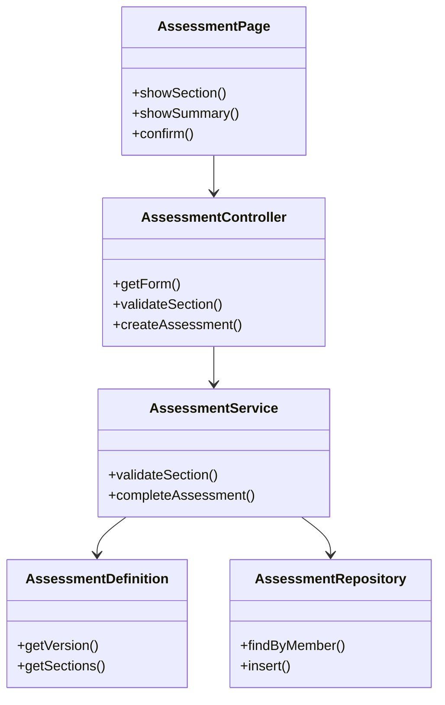
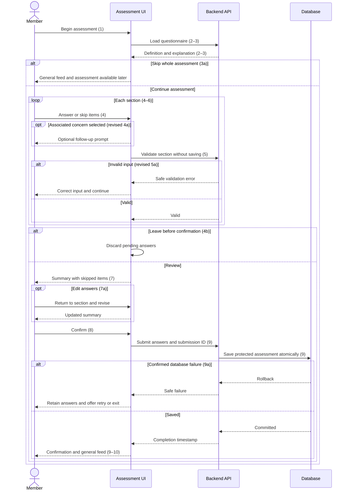

# Account and Profile Design

**Project:** Well Live  
**Team:** Team 07  
**Area:** ACC  
**Status:** Draft for teammate review; implementation blockers remain.

> **Realizes:** `UC-ACC-complete-assessment`
>
> **Depends on:** `BR-no-mandatory-health-disclosure`,
> `BR-health-data-protection`, `BR-non-diagnostic`,
> `BR-not-medical-device`, `BR-five-pillars`, and
> `SEC-protected-data`.
>
> **See:** [Use cases](../requirements/use-cases.md),
> [Business rules](../requirements/business-rules.md),
> [Specification](../requirements/software-requirements-specification.md),
> [Architecture](architectural-design.md), and
> [Sarah's questionnaire](../health%20assessment.docx).
>
> **Designed against:** `a2f44e9`, the main revision reported by
> the owner when creating `design-health-assessment`.
> Current application code and reusable implementations must be
> checked before implementation.

## Overview

The ACC area implements assessment completion through the Frontend
Client and Backend API described in the architecture. It obtains the
member's identity from Identity and Access and persists protected
assessment answers in the Relational Database. Sarah's questionnaire
supplies the section headings and item wording. The response behavior
agreed by the pair must be recorded in the cited use case before this
design is approved.

This slice saves the assessment and returns the member to the general
educational feed. It does not implement personalization or questionnaire
administration.

## Components & classes

The following are proposed new responsibilities. Their paths are
relative to the frontend and backend source roots, which the team must
fix when choosing the backend stack. None is claimed as existing code.

| Proposed path | Status | Responsibility |
|---|---|---|
| `frontend/<source-root>/acc/AssessmentPage` | New | Section navigation, pending answers, summary, confirmation and retry |
| `backend/<source-root>/acc/AssessmentController` | New | HTTP request and response handling |
| `backend/<source-root>/acc/AssessmentService` | New | Validation, ownership, submission reconciliation and atomic completion |
| `backend/<source-root>/acc/AssessmentRepository` | New | Assessment persistence and member uniqueness |
| `backend/<source-root>/acc/AssessmentDefinition` | New | Fixed questionnaire version, stable identifiers and source wording |

Identity, encryption, error handling and clock implementations are shared
architectural responsibilities. Their existence must be checked; if
absent, the implementation plan must name the new shared files.

## Sequence

### UC-ACC-complete-assessment

Step and extension references use the existing use case. Reconcile
their descriptions in the requirements changes before merging.

If the save response is lost, the member can retry using the same
submission ID. This recovery behavior must be added to the use case.

## API contract

The authenticated member comes from the session, never from a
client-supplied owner field. All operations require authenticated,
authorized access. Errors follow architecture section 8.2.

| Endpoint | Caller | Request | Success | Errors |
|---|---|---|---|---|
| `GET /api/assessment/form` | Signed-in member | None | `200`: version and sections with stable item IDs, wording, input metadata and follow-up associations | `401` unauthenticated; `403` unauthorized; `503` dependency unavailable |
| `POST /api/assessment/section-validations` | Signed-in member | Form version, section ID and pending answers | `200`: valid; nothing persisted | `400` malformed request; `401`; `403`; `409 FORM_CHANGED`; `422 VALIDATION_FAILED` |
| `POST /api/assessment` | Signed-in member completing their own assessment | Form version, submission ID and confirmed answers | `201`: original completion timestamp, including a successful retry of the same submission | `400`; `401`; `403`; `409 ASSESSMENT_EXISTS`; `409 SUBMISSION_ID_REUSED`; `409 FORM_CHANGED`; `422`; `503` confirmed save failure |

Unexpected server failures return a user-safe `500` response without
stack traces or answer values.

Answer fields distinguish concern responses, numeric values with units,
optional basic text and follow-up text. Final submission normalizes
unanswered items exactly as the confirmation summary does.

Validation rules belong in the use case's Associated Information.
The API enforces those rules on the server, including on final save.

The fixed questionnaire version is `1`. Reject any other submitted
version without saving. Retain pending answers and explain that the
form must be reloaded; do not silently discard them.

## Key decisions

**Keep pending answers in page memory until confirmation.**
Rejected: saving each section, because leaving or skipping the whole
assessment must create no assessment. Reloading or closing the page
discards pending answers.

**Save one assessment atomically.**
Rejected: independent writes for answers and completion metadata,
because failure could leave partial completion.

**Enforce one assessment per member in the database.**
Rejected: checking only before insertion, because concurrent requests
could both pass that check.

**Use a member-scoped submission ID for retry reconciliation.**
Save the submission ID with the assessment in the same transaction.
A retry with the same ID and equivalent normalized answers returns
the original success and timestamp. A different payload with that ID
returns `409 SUBMISSION_ID_REUSED`. A different ID after completion
returns `409 ASSESSMENT_EXISTS`.

Rejected: treating every retry as a new submission, because a lost
response could cause a successful save to appear to have failed.
Compare against the protected stored answers after authorized
decryption; do not store a plaintext copy for comparison.

**Use a fixed questionnaire definition for this release.**
Rejected: adding an editor or administration workflow, because those
capabilities are outside this use case. Stable IDs are assigned once
and never generated dynamically from display wording.

## Data model

Add one Assessment associated with one Member:

- Unique member reference.
- Questionnaire version.
- Protected normalized answers, including section-level follow-up text.
- Member-scoped submission ID.
- Server-generated UTC completion timestamp.

Concern answers preserve Concern, No concern and Skipped distinctly.
Skipped basic-information answers use an explicit absent value.
Height and weight retain the entered numeric value and selected unit.

Use a database uniqueness constraint for the member reference.
The migration file path, concrete column types and encryption
implementation depend on the unresolved backend stack.

No personalization setting is created or changed by this slice.
Any conflicting completion postcondition must be corrected in the
requirements PR.

## Reuse & cross-cutting

Apply these named conventions from the architecture:

- Section 8.1: authentication, authorization and sensitive-data protection.
- Section 8.2: Error handling.
- Section 8.2: Time and time zones.
- Section 8.2: Validation and authorization.
- Section 8.2: Configuration and secrets.
- Section 8.2: Logging.
- Section 8.2: Testing.
- Section 8.2: Persistence and concurrency.

Verify shared code before claiming reuse. Use established encryption
and authentication facilities rather than custom cryptography.

## Tests

| Use case, flow | Level | Asserts |
|---|---|---|
| Main success | Integration and UI | Summary matches entered values; confirmation creates one protected assessment and UTC timestamp and opens the general feed |
| 3a: skip whole assessment | UI and integration | No assessment is created; member can take it later |
| Revised 4a: follow-up | UI | Associated Concern reveals Sarah's prompt; text is optional |
| Revised 5a: invalid input | Unit and integration | Invalid units, numeric values or text receive safe errors without saving |
| 4b: leave | UI and integration | Pending answers are discarded and nothing is saved |
| 7a: edit summary | UI | Revised values appear in summary and final submission |
| 9a: save failure | Integration | Failure rolls back the assessment; UI retains answers for retry |
| Three concern responses | Unit and integration | Concern, No concern and Skipped remain distinct |
| Untouched items | UI and integration | Summary and persisted answers normalize untouched items to Skipped |
| All skipped | Integration | Confirmation creates a completed assessment with no disclosed answers |
| Text boundaries | Unit | Trimmed text at 500 Unicode code points passes; 501 fails; blank text becomes skipped |
| Numeric boundaries | Unit | Positive finite height/weight with at most two decimal places and valid units pass; invalid values fail; age accepts integers 0–150 |
| Family follow-up | UI and integration | One optional section text appears when any family item is Concern; absent when none is Concern |
| Unauthenticated access | Integration | Every endpoint refuses unauthenticated requests without returning or saving protected data |
| Ownership | Service integration | Member identity comes from the trusted session; another member cannot select an owner or access saved answers |
| Concurrent creation | Database integration | Two different submissions create exactly one assessment; the loser receives conflict |
| Lost response and retry | Integration | Retrying the same ID and answers returns the original timestamp without another insert |
| Changed retry payload | Integration | Same ID with different normalized answers returns conflict and leaves stored answers unchanged |
| Concurrent identical retry | Database integration | Same member and submission ID submitted concurrently yields one record and successful reconciliation |
| Questionnaire version | Integration | Unsupported version returns conflict without saving or silently discarding pending UI answers |
| Protection | Integration | Stored answers are encrypted; operational logs and errors omit answer values |
| Follow-up removal | UI and integration | Changing Concern to No concern or Skipped removes associated follow-up from the submitted answers |

Concrete test commands and file paths must be added after the stack
and test framework are selected.

## Changes to the architecture-of-record

No container or responsibility changes are proposed.

Before implementation, record the backend stack decision in the
architecture-of-record, including a rejected alternative and reason.
Confirm source-root conventions and shared security implementations.

## Open questions & risks

| Question or risk | Owner | Effect |
|---|---|---|
| Backend framework, database integration, test tools and source roots | Team | Blocks concrete implementation paths and test commands |
| Codex command runner cannot start | Owner/tool environment | Prevents independent local inspection and automated file changes |
| Questionnaire collection scope, retention and explanation of use | Sarah and team | Must be recorded in OPEN-ISSUES.md; unresolved production behavior |
| Response to sensitive concern selections | Sarah and team | No alert or intervention behavior may be inferred |
| Existing member terminology versus subscriptions | Team | Resolve authorization terminology without inventing an MVP subscription gate |
| Requirements still describe placeholder questions and universal Other | Pair | Must align use case, rules and associated information before approval |
| No verified implementation baseline | Pair | Check current tree and source before implementation |
| Complete questionnaire source not yet mapped to stable IDs | Pair | Add the full mapping before implementation; examples alone are insufficient |

Use fictitious assessment answers for development and demonstration
while client collection and response questions remain unresolved.
This does not by itself establish readiness for real member use.

## Working this document with your agent

The agent may draft contracts, diagrams, file mappings and tests.
The pair owns decisions; a teammate who did not draft the design
reviews and approves the pull request.

Do not begin implementation until the design is merged and its
implementation blockers are resolved.

## The questions test

Start a fresh agent session and provide this design, the use case,
its referenced business rules and architecture section 8.

Ask:

> List every point you would still have to guess to implement
> UC-ACC-complete-assessment. For each, say what you would guess
> and whether a wrong guess could violate a requirement.
> Do not write code.

Resolve each finding in the requirements or design, or explain why
the remaining guess cannot violate a requirement. Include the findings
and dispositions in the PR description under:

Questions test

Pending: run in a fresh session before requesting approval.

