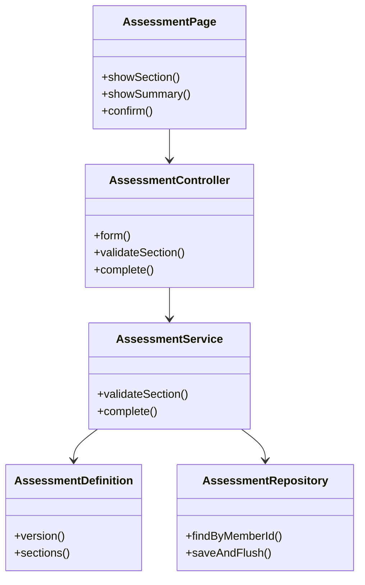

# Account and Profile Design

**Project:** Well Live  
**Team:** Team 07  
**Area:** ACC  
**Status:** Draft for teammate review; a proving-slice implementation exists, but approval blockers remain.

> **Realizes:** `UC-ACC-complete-assessment`
>
> **Depends on:** `BR-no-mandatory-health-disclosure`,
> `BR-health-data-protection`, `BR-non-diagnostic`,
> `BR-not-medical-device`, `BR-five-pillars`, and
> `SEC-protected-data`.
>
> **See:** [Use cases](../requirements/use-cases.md),
> [Business rules](../requirements/business-rules.md),
> [Specification](../requirements/software-requirements-specification.md),
> [Architecture](architectural-design.md), and
> [Sarah's questionnaire](../health%20assessment.docx).
>
> **Designed against:** `a2f44e9`, the main revision reported by
> the owner when creating `design-health-assessment`. The current
> implementation is in [`backend/`](../../backend/); reconcile this
> design and the requirements against that code before approval.

## Overview

The ACC proving slice is implemented as a Java 21 / Spring Boot API in
[`backend/`](../../backend/). Spring Security supplies the authenticated
member session; the API serves the fixed questionnaire, validates pending
sections without persistence, then atomically stores one encrypted,
normalized submission per member. Sarah's questionnaire supplies the
section headings and item wording. The response semantics, collection
policy and exact disclosure text still require review against the cited
use case before the design is approved.

The backend handles assessment completion only; skip/leave behavior remains
on the frontend and creates no row. It does not implement personalization,
assessment updates or questionnaire administration.

## Components & classes

The backend paths below are implemented. The frontend remains a separate
client; its current branch is not part of this source tree.



| Path | Status | Responsibility |
|---|---|---|
| `backend/src/main/java/com/welllive/backend/assessment/AssessmentController.java` | Implemented | Form, section-validation and completion routes |
| `backend/src/main/java/com/welllive/backend/assessment/AssessmentService.java` | Implemented | Validation, normalization, member ownership, retry reconciliation and atomic completion |
| `backend/src/main/java/com/welllive/backend/repository/AssessmentRepository.java` | Implemented | Assessment persistence; one row per member is enforced by the database |
| `backend/src/main/java/com/welllive/backend/assessment/AssessmentDefinition.java` | Implemented | Fixed version 1 questionnaire and stable question IDs |
| `backend/src/main/java/com/welllive/backend/auth/` | Implemented | Member registration, session authentication and current-member identity |
| `backend/src/main/java/com/welllive/backend/security/AssessmentAnswerProtector.java` | Implemented | AES-GCM answer encryption using a key configured outside the database |

## Sequence

### UC-ACC-complete-assessment

Step and extension references use the existing use case. Reconcile
their descriptions in the requirements changes before merging.

```mermaid
sequenceDiagram
    actor M as Member
    participant UI as Assessment UI
    participant API as Backend API
    participant DB as Database

    M->>UI: Begin assessment (1)
    UI->>API: Load questionnaire (2–3)
    API-->>UI: Definition and explanation (2–3)

    alt Skip whole assessment (3a)
        UI-->>M: General feed; assessment available later
    else Continue assessment
        loop Each section (4–6)
            M->>UI: Answer or skip items (4)
            opt Associated concern selected (revised 4a)
                UI-->>M: Optional follow-up prompt
            end
            UI->>API: Validate section without saving (5)
            alt Invalid input (revised 5a)
                API-->>UI: Safe validation error
                UI-->>M: Correct input and continue
            else Valid
                API-->>UI: Valid
            end
        end

        alt Leave before confirmation (4b)
            UI->>UI: Discard pending answers
        else Review
            UI-->>M: Summary with skipped items (7)
            opt Edit answers (7a)
                M->>UI: Return to section and revise
                UI-->>M: Updated summary
            end
            M->>UI: Confirm (8)
            UI->>API: Submit answers and submission ID (9)
            API->>DB: Save protected assessment atomically (9)
            alt Confirmed database failure (9a)
                DB-->>API: Rollback
                API-->>UI: Safe failure
                UI-->>M: Retain answers; offer retry or exit
            else Saved
                DB-->>API: Committed
                API-->>UI: Completion timestamp
                UI-->>M: Confirmation and general feed (9–10)
            end
        end
    end
```

If the save response is lost, the member can retry using the same
submission ID. This recovery behavior must be added to the use case.

## API contract

The authenticated member comes from the session, never from a
client-supplied owner field. All assessment operations require authenticated,
authorized access. The unauthenticated `GET /api/auth/csrf` endpoint only
initializes the browser CSRF cookie/header needed for account creation and
sign-in; it does not read or write member data. Errors follow architecture
section 8.2.

| Endpoint | Caller | Request | Success | Errors |
|---|---|---|---|---|
| `GET /api/assessment/form` | Signed-in member | None | `200`: version and sections with stable item IDs, wording, input metadata and follow-up associations | `401` unauthenticated; `403` unauthorized; `503` dependency unavailable |
| `POST /api/assessment/section-validations` | Signed-in member | Form version, section ID and pending answers | `200`: valid; nothing persisted | `400` malformed request; `401`; `403`; `409 FORM_CHANGED`; `422 VALIDATION_FAILED` |
| `POST /api/assessment` | Signed-in member completing their own assessment | Form version, submission ID and confirmed answers | `201`: original completion timestamp, including a successful retry of the same submission | `400`; `401`; `403`; `409 ASSESSMENT_EXISTS`; `409 SUBMISSION_ID_REUSED`; `409 FORM_CHANGED`; `422`; `503` confirmed save failure |

Unexpected server failures return a user-safe `500` response without
stack traces or answer values.

Answer fields distinguish Concern, No concern, Skipped and Others responses,
numeric values with units, optional basic text and follow-up text. The concern
options are served by the backend in that order, with Others last; Others
requires a short text value. Height, weight and age remain typed numeric
fields, while profile details remain typed text. Final submission normalizes
unanswered items exactly as the confirmation summary does.

Validation rules belong in the use case's Associated Information.
The API enforces those rules on the server, including on final save.

The fixed questionnaire version is `1`. Reject any other submitted
version without saving. Retain pending answers and explain that the
form must be reloaded; do not silently discard them.

## Key decisions

**Keep pending answers in page memory until confirmation.**
Rejected: saving each section, because leaving or skipping the whole
assessment must create no assessment. Reloading or closing the page
discards pending answers.

**Save one assessment atomically.**
Rejected: independent writes for answers and completion metadata,
because failure could leave partial completion.

**Enforce one assessment per member in the database.**
Rejected: checking only before insertion, because concurrent requests
could both pass that check.

**Use a member-scoped submission ID for retry reconciliation.**
Save the submission ID with the assessment in the same transaction.
A retry with the same ID and equivalent normalized answers returns
the original success and timestamp. A different payload with that ID
returns `409 SUBMISSION_ID_REUSED`. A different ID after completion
returns `409 ASSESSMENT_EXISTS`.

Rejected: treating every retry as a new submission, because a lost
response could cause a successful save to appear to have failed.
Compare against the protected stored answers after authorized
decryption; do not store a plaintext copy for comparison.

**Use a fixed, backend-owned questionnaire definition for this release.**
The frontend renders the definition returned by `GET /api/assessment/form`.
Changing questions or options requires a backend code change and redeploy;
it does not require a separate frontend question-list change. Rejected:
database-managed editing, an editor or administration workflow, because
those capabilities are outside this use case. Stable IDs are assigned once
and never generated dynamically from display wording.

## Data model

Add one Assessment associated with one Member:

- Unique member reference.
- Questionnaire version.
- Protected normalized answers, including section-level follow-up text.
- Member-scoped submission ID.
- Server-generated UTC completion timestamp.

Concern answers preserve Concern, No concern, Skipped and Others distinctly;
Others stores its short text in the protected answer document.
Skipped basic-information answers use an explicit absent value.
Height and weight retain the entered numeric value and selected unit.

Use a database uniqueness constraint for the member reference. The Flyway
migration is `backend/src/main/resources/db/migration/V1__create_members_and_assessments.sql`.
Answers are AES-GCM protected, with the member ID used as authenticated
additional data; the key is injected through configuration and is not stored
in the database.

No personalization setting is created or changed by this slice.
Any conflicting completion postcondition must be corrected in the
requirements PR.

## Reuse & cross-cutting

Apply these named conventions from the architecture:

- Section 8.1: authentication, authorization and sensitive-data protection.
- Section 8.2: Error handling.
- Section 8.2: Time and time zones.
- Section 8.2: Validation and authorization.
- Section 8.2: Configuration and secrets.
- Section 8.2: Logging.
- Section 8.2: Testing.
- Section 8.2: Persistence and concurrency.

Verify shared code before claiming reuse. Use established encryption
and authentication facilities rather than custom cryptography.

## Tests

| Use case, flow | Level | Asserts |
|---|---|---|
| Main success | Integration and UI | Summary matches entered values; confirmation creates one protected assessment and UTC timestamp and opens the general feed |
| 3a: skip whole assessment | UI and integration | No assessment is created; member can take it later |
| Revised 4a: follow-up | UI | Associated Concern reveals Sarah's prompt; text is optional |
| Revised 5a: invalid input | Unit and integration | Invalid units, numeric values or text receive safe errors without saving |
| 4b: leave | UI and integration | Pending answers are discarded and nothing is saved |
| 7a: edit summary | UI | Revised values appear in summary and final submission |
| 9a: save failure | Integration | Failure rolls back the assessment; UI retains answers for retry |
| Concern response choices | Unit and integration | Concern, No concern, Skipped and Others remain distinct; Others requires short text and is last in the form options |
| Untouched items | UI and integration | Summary and persisted answers normalize untouched items to Skipped |
| All skipped | Integration | Confirmation creates a completed assessment with no disclosed answers |
| Text boundaries | Unit | Trimmed text at 500 Unicode code points passes; 501 fails; blank text becomes skipped |
| Numeric boundaries | Unit | Positive finite height/weight with at most two decimal places and valid units pass; invalid values fail; age accepts integers 0–150 |
| Family follow-up | UI and integration | One optional section text appears when any family item is Concern; absent when none is Concern |
| Unauthenticated access | Integration | Every endpoint refuses unauthenticated requests without returning or saving protected data |
| Ownership | Service integration | Member identity comes from the trusted session; another member cannot select an owner or access saved answers |
| Concurrent creation | Database integration | A per-member database lock and unique member key serialize creation; a different submission after completion receives conflict |
| Lost response and retry | Integration | Retrying the same ID and answers returns the original timestamp without another insert |
| Changed retry payload | Integration | Same ID with different normalized answers returns conflict and leaves stored answers unchanged |
| Concurrent identical retry | Database integration | Same member and submission ID submitted concurrently yields one record and successful reconciliation |
| Questionnaire version | Integration | Unsupported version returns conflict without saving or silently discarding pending UI answers |
| Protection | Integration and unit | Stored answers are encrypted, cryptographically bound to their member, and operational logs and errors omit answer values |
| Follow-up removal | UI and integration | Changing Concern to No concern or Skipped removes associated follow-up from the submitted answers |

The automated API tests are in
`backend/src/test/java/com/welllive/backend/AssessmentApiIntegrationTest.java`.
The answer-protection unit test is in
`backend/src/test/java/com/welllive/backend/AssessmentAnswerProtectorTest.java`.
They cover authentication, CSRF, fixed form delivery, section validation,
protected persistence, version and value rejection, idempotent retry and
concurrent identical submissions. Run the tests with
`mvn -f backend/pom.xml test`. UI-only behaviors remain to be tested with the
frontend.

## Changes to the architecture-of-record

No container or responsibility changes are proposed.

The selected stack and rejected alternative are recorded as
`KD-backend-stack` in the
[architecture-of-record](architectural-design.md#92-key-decisions). The
implementation uses the repository-root `backend/` source tree, Spring
Security sessions, AES-GCM encryption and UTC `Clock`.

## Open questions & risks

| Question or risk | Owner | Effect |
|---|---|---|
| Production host, managed database operations and key rotation | Team | Must be decided before deployment with real member data |
| Questionnaire collection scope, retention and explanation of use | Sarah and team | Must be recorded in OPEN-ISSUES.md; unresolved production behavior |
| Response to sensitive concern selections | Sarah and team | No alert or intervention behavior may be inferred |
| Existing member terminology versus subscriptions | Team | Resolve authorization terminology without inventing an MVP subscription gate |
| Requirements still describe placeholder questions and universal Other | Pair | Must align use case, rules and associated information before approval |
| Response semantics and stable-ID mapping | Pair and Sarah | Version 1 maps every questionnaire item; confirm the mappings and answer choices before freezing the client contract |

Use fictitious assessment answers for development and demonstration
while client collection and response questions remain unresolved.
This does not by itself establish readiness for real member use.

## Working this document with your agent

The agent may draft contracts, diagrams, file mappings and tests.
The pair owns decisions; a teammate who did not draft the design
reviews and approves the pull request.

The proving slice exists to exercise the API contract, not to waive the
design-review gate. Do not merge it as a production feature or enable
assessment collection with real member data until the remaining review and
privacy/safety decisions are resolved.

## The questions test

Start a fresh agent session and provide this design, the use case,
its referenced business rules and architecture section 8.

Ask:

> List every point you would still have to guess to implement
> UC-ACC-complete-assessment. For each, say what you would guess
> and whether a wrong guess could violate a requirement.
> Do not write code.

Resolve each finding in the requirements or design, or explain why
the remaining guess cannot violate a requirement. Include the findings
and dispositions in the PR description under:

<details>
<summary>Questions test</summary>

Pending: run in a fresh session before requesting approval.

</details>
